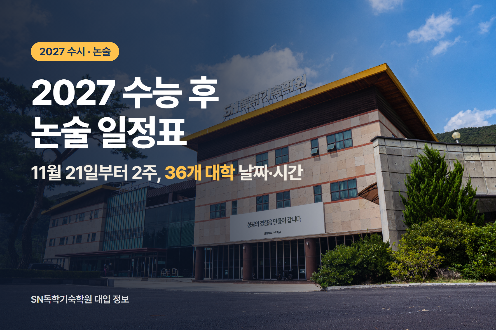
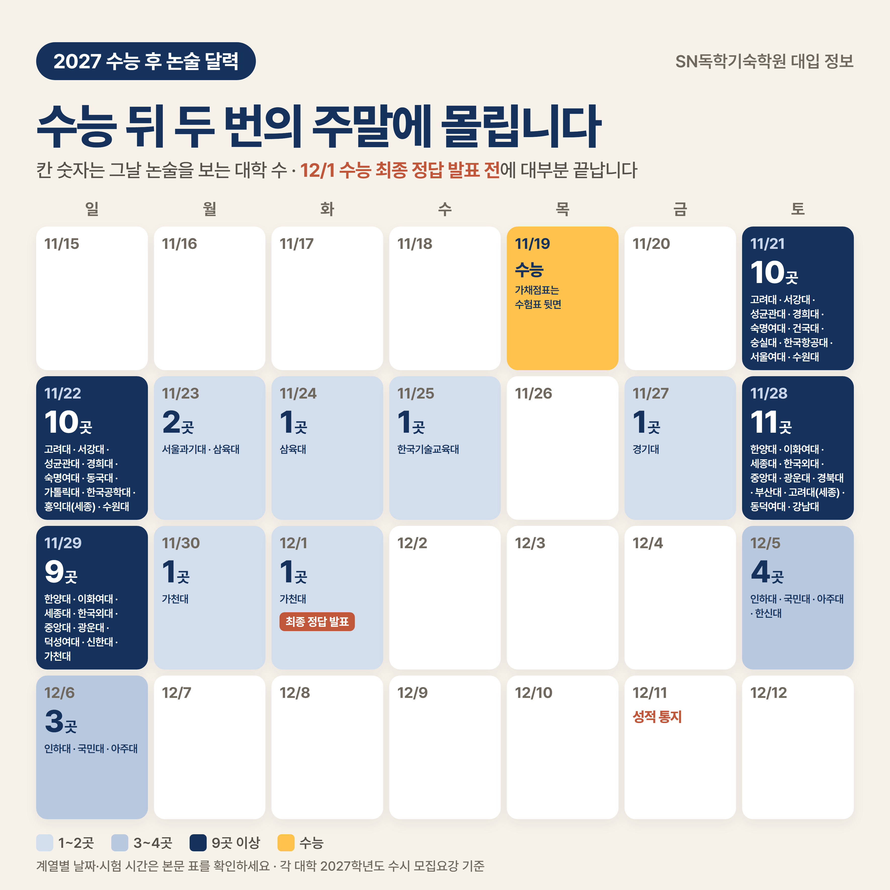
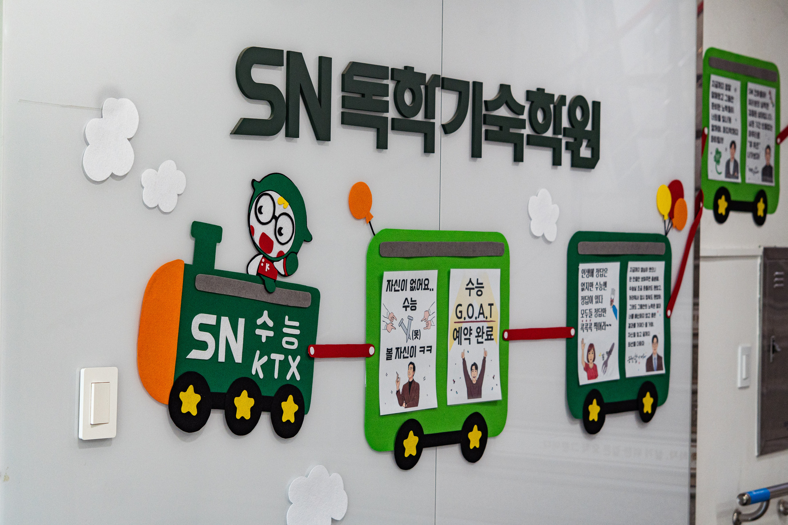
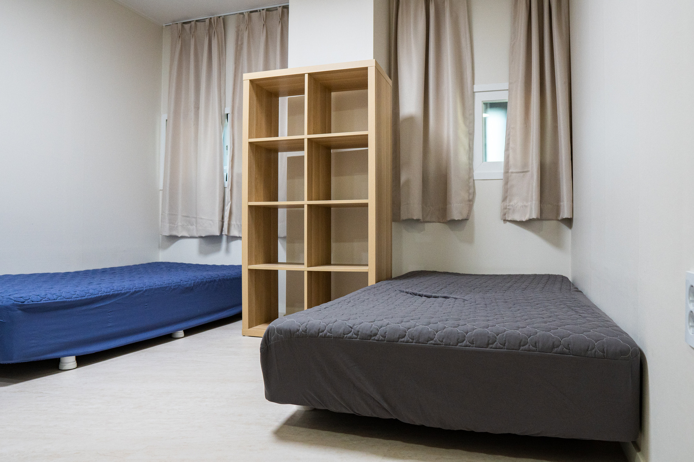
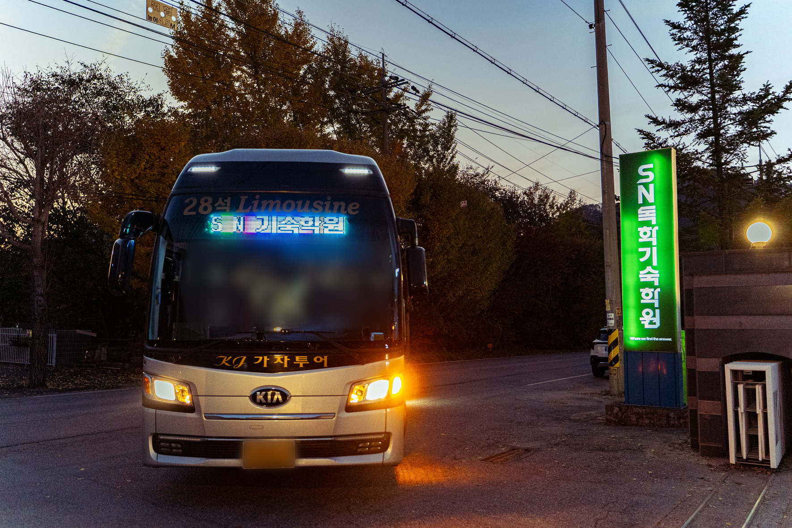

2027학년도 수능은 2026년 11월 19일(목)에 치러집니다. 그리고 이틀 뒤인 **11월 21일(토)부터 12월 6일(일)까지, 36개 대학이 수능 후 논술을 봅니다.**

수능을 마치고 첫 논술까지 남은 시간은 단 이틀입니다. 가채점으로 수능 최저를 따져 보고, 어느 대학 논술에 갈지 정하고, 고사장 공지까지 챙기려면 일정은 수능 전에 미리 정리해 두는 편이 좋습니다.

이 글은 각 대학 2027학년도 수시 모집요강과 입학처 공지를 하나씩 대조해 날짜별·대학별로 정리한 것입니다(2026년 10월 20일 기준). 대학별 표는 가나다순이라 지원한 대학을 바로 찾을 수 있습니다.

> 이 글은 SN독학기숙학원 네이버 블로그에 먼저 실린 글을 옮겨 정리했습니다. [네이버 블로그 원문 보기](https://blog.naver.com/snacademy/224450041339)

## 한눈에 보기

| 항목 | 내용 |
|---|---|
| 수능 후 논술 | 11/21(토)~12/6(일), 36개 대학 |
| 가장 붐비는 날 | 11/28(토) 11곳, 11/21(토)·22(일) 각 10곳 |
| 수능 전에 남은 논술 | 상명대 10/30(금)·31(토), 서경대 11/1(일) |
| 수능 최저 없는 논술 | 수능 후 10곳과 아주대·인하대·중앙대 일부, 수능 전 2곳 |
| 수능 최종 정답 발표 | 12/1(화), 36곳 중 31곳은 그 전에 논술이 끝남 |
| 수시 합격자 발표 | 12/18(금)까지 |

## Q1. 수능 후 논술, 날짜별로 어디가 겹치나요?

수능 후 논술이 가장 몰리는 날은 11/28(토)로 11곳이 시험을 보고, 11/21(토)·22(일)에도 각 10곳이 시험을 봅니다.

| 날짜 | 대학 |
|---|---|
| 11/21(토) | 고려대(자연), 서강대(자연), 성균관대(언어형), 경희대(인문·체육, 의약학), 숙명여대(자연, 인문 일부), 건국대, 숭실대, 한국항공대, 서울여대, 수원대(자연) |
| 11/22(일) | 고려대(인문), 서강대(인문), 성균관대(수리형), 경희대(자연, 경영·정경 등 사회계열), 숙명여대(인문 일부), 동국대, 가톨릭대(의예·약학), 한국공학대, 홍익대(세종), 수원대(인문) |
| 11/23(월)~24(화) | 서울과기대(23일), 삼육대(23~24일) |
| 11/25(수) | 한국기술교육대 |
| 11/27(금) | 경기대 |
| 11/28(토) | 한양대(상경·인문), 이화여대(인문), 세종대(인문·자유전공), 한국외대(일부), 중앙대(자연), 광운대(자연), 경북대, 부산대, 고려대(세종), 동덕여대, 강남대 |
| 11/29(일) | 한양대(자연), 이화여대(자연), 세종대(자연), 한국외대(일부), 중앙대(인문), 광운대(인문), 덕성여대, 신한대, 가천대(의예·한의예·약학) |
| 11/30(월) | 가천대(인문·간호·바이오로직스·화공생명배터리) |
| 12/1(화) | 가천대(자연) |
| 12/5(토) | 인하대(인문), 국민대(인문), 아주대(자연·의학), 한신대 |
| 12/6(일) | 인하대(자연·의예), 국민대(자연), 아주대(인문·약학) |

수능 후 논술은 같은 대학이라도 계열이나 전형에 따라 시험 날짜와 시간이 나뉘는 곳이 많습니다.

- **토·일로 나뉘는 곳** : 고려대는 자연계열이 11/21(토), 인문계열이 11/22(일)에 봅니다.
- **계열 대신 유형으로 나뉘는 곳** : 성균관대는 언어형이 11/21(토), 수리형이 11/22(일)입니다.
- **같은 날 오전·오후로 나뉘는 곳** : 경희대는 11/21(토) 오전에 인문·체육계, 오후에 의약학계가 봅니다.

같은 날 두 곳이 겹치면 대부분 한 곳만 볼 수 있습니다. **다만 시간이 오전과 저녁으로 갈리면 하루에 두 곳도 볼 수 있습니다.** 예를 들어 11/21(토)에는 오전 건국대(인문·통합)와 저녁 숭실대(경상계열)가 겹치지 않습니다.

## Q2. 내가 지원한 대학 논술은 언제, 몇 시에 보나요?

가나다순으로 정리했습니다. 시험 시간이 「공지 예정」인 대학은 오른쪽 공지일에 고사장과 함께 시간이 나옵니다. 아래 시간은 2026년 10월 20일 기준이며, 고사장 공지 때 바뀔 수 있습니다. 개별 통보는 하지 않으니, 본인이 지원한 대학의 공지일을 달력에 적어 두세요.

| 대학 | 수능 최저 | 시험일(계열) | 시험 시간 | 고사장 공지일 |
|---|---|---|---|---|
| 가천대 | 있음 | 11/29(일) 의예·한의예·약학 11/30(월) 인문·간호 등 12/1(화) 자연 | 공지 예정 | 11/17(화) |
| 가톨릭대 | 있음 | 11/22(일) 의예·약학만 | 의예 10:00~11:40 약학 10:00~11:30 | 고사 3일 전 |
| 강남대 | **없음** | 11/28(토) | 인문사회계 10:00 공학계·자유전공학부 14:00 (시험 60분) | 11/20(금) |
| 건국대 | 있음 | 11/21(토) | 인문·통합 09:20~11:00 자연 14:00~15:40 | 고사 3~4일 전 |
| 경기대 | **없음** | 11/27(금) | 공지 예정 | 11/20(금) |
| 경북대 | 있음 | 11/28(토) | 입실 마감 인문 09:00, 자연계열1 15:00, 자연계열2 16:00 | 11/24(화) |
| 경희대 | 있음 | 11/21(토) 인문·체육, 의약학 11/22(일) 자연, 경영·정경 등 사회계 | 11/21 인문·체육 09:00~11:00, 의약학 15:00~17:00 11/22 자연 09:00~11:00, 사회계 15:00~17:00 | 11/18(수) |
| 고려대 | 있음 | 11/21(토) 자연 11/22(일) 인문 | 입실 마감 08:30 또는 12:30 (모집단위별, 시험 80분) | 11/17(화) |
| 고려대(세종) | 있음 | 11/28(토) | 입실 마감 09:40 약학과는 14:30 (시험 120분) | 11/26(목) |
| 광운대 | **없음** | 11/28(토) 자연 11/29(일) 인문 | 10:00~12:00 또는 14:30~16:30 (모집단위별, 두 날 같음) | 고사 3일 전 |
| 국민대 | 있음 | 12/5(토) 인문 12/6(일) 자연 | 오전반 09:00~10:30 오후반 15:00~16:30 (모집단위별, 두 날 같음) | 11/30(월) |
| 덕성여대 | 있음 | 11/29(일) | 자연(과학기술·약학) 09:30~11:00 인문·사회 14:30~16:00 | 11/24(화) |
| 동국대 | 있음 | 11/22(일) | 자연 09:30~11:00 인문(사회과학·경영) 13:00~14:40 인문(문과·법과 등) 16:30~18:10 | 11/18(수) |
| 동덕여대 | 있음 | 11/28(토) | 인문사회 10:00~11:00 자연 14:30~15:30 | 11/25(수) |
| 부산대 | 있음 | 11/28(토) | 자연 09:30~11:10 인문·사회 15:30~17:10 | 11/24(화) |
| 삼육대 | 있음 | 11/23(월)~24(화) 응시일·시간은 11/18 공지 | 공지 예정 | 11/18(수) |
| 서강대 | 있음 | 11/21(토) 자연 11/22(일) 인문 | 16:00~17:40 또는 19:00~20:40 (모집단위별, 두 날 같음) | 11월 중 |
| 서울과기대 | **없음** | 11/23(월) | 11:00~12:40 | 입학처 공지 |
| 서울여대 | **없음** | 11/21(토) | 인문사회 10:00~11:30 자연 14:30~16:00 | 고사 3일 전 |
| 성균관대 | 있음 | 11/21(토) 언어형 11/22(일) 수리형 (의예·약학 포함) | 11/21 언어형 08:30~10:10, 13:00~14:40 11/22 수리형 08:30~10:10, 13:00~14:40, 17:00~18:40 (모집단위별 교시, 의예·약학 17:00) | 11/3(화) |
| 세종대 | 있음 | 11/28(토) 인문·자유전공 11/29(일) 자연 | 11/28 인문 09:00~11:00, 자유전공 14:00~16:00 11/29 인공지능융합 09:00~11:00, 자연과학·생명과학·공과 14:00~16:00 | 11/20(금) |
| 수원대 | **없음** | 11/21(토) 자연 11/22(일) 인문 | 공지 예정 | 고사 일주일 전 |
| 숙명여대 | 있음 | 11/21(토) 자연, 인문 일부 11/22(일) 인문 일부 | 11/21 자연 10:00~11:40, 인문 일부·의류학과 14:30~16:10 11/22 인문 일부 10:00~11:40 | 11/17(화) |
| 숭실대 | 있음 | 11/21(토) | 자연 10:00~11:40, 인문 15:00~16:40 경상계열 18:30~20:10 | 11/17(화) |
| 신한대 | **없음** | 11/29(일) | 09:20부터(전 모집단위) | 입학처 공지 |
| 아주대 | 의학·약학 외 **없음** | 12/5(토) 자연·의학 12/6(일) 인문·약학 | 12/5 공과·자연과학 등 09:00, 첨단ICT·소프트웨어융합 14:00, 의학 19:00 12/6 경영·인문·사회과학 등 09:00, 약학 14:00 | 입학처 공지 |
| 이화여대 | 있음 | 11/28(토) 인문 11/29(일) 자연 | 11/28 인문 08:30~12:10 또는 14:20~18:00 11/29 자연 08:30~12:10, 의예·약학 14:20~18:00 (모집단위별, 시험 100분) | 11/24(화) |
| 인하대 | 의예 외 **없음** | 12/5(토) 인문 12/6(일) 자연·의예 | 12/5 인문 09:00~10:40 12/6 자연 09:00~10:40 또는 13:30~15:10 (모집단위별, 의예 13:30) | 11/18(수) |
| 중앙대 | 다빈치캠퍼스만 **없음** | 11/28(토) 자연 11/29(일) 인문 (수능 후는 일반형) | 모집단위별 10:00~12:00 또는 14:00~16:00 | 11/24(화) |
| 한국공학대 | **없음** | 11/22(일) | 모집단위별 10:00 또는 14:30 | 11/19(목) |
| 한국기술교육대 | **없음** | 11/25(수) | 공학융합 10:00~11:20 ICT융합·사회융합 14:00~15:20 | 입학처 공지 |
| 한국외대 | 있음 | 11/28(토)·29(일) 모집단위별, 자연·공과는 11/29(일) | 모집단위별 10:00~11:30 또는 15:00~16:30 | 11/25(수) |
| 한국항공대 | 있음 | 11/21(토) | 공과·AI융합 등 10:00~11:30 항공·경영 등 15:00~16:30 | 11/19(목) |
| 한신대 | **없음** | 12/5(토) | 인문 10:00~11:20 자연 14:30~15:50 | 11/16(월)부터 |
| 한양대 | 있음 | 11/28(토) 상경·인문 11/29(일) 자연 | 11/28 상경 09:30~11:00, 인문 13:30~15:00 또는 17:00~18:30 11/29 자연 09:30~11:00, 13:30~15:00, 17:00~18:30 (모집단위별, 의예 17:00) | 11/23(월) 이후 |
| 홍익대(세종) | 있음 | 11/22(일) | 자연 10:00까지 입실 인문 15:00까지 입실 | 11/11(수) 수험표 출력 |

특히 헷갈리기 쉬운 곳이 있습니다.

- **성균관대는 계열이 아니라 논술 유형으로 날짜가 갈립니다.** 언어형은 11/21(토), 수리형은 11/22(일)이고 의예·약학은 수리형입니다. 같은 성균관대 지원자라도 시험 날짜가 다를 수 있으니, 지원한 모집단위의 유형을 미리 확인해 두시면 좋습니다.
- **중앙대와 가톨릭대는 논술 시험이 수능 전과 수능 후에 한 번씩 있습니다.** 1차·2차로 이어지는 시험이 아니라, 전형이나 학과에 따라 시험 날짜가 다를 뿐입니다.
  - 중앙대 : 창의형은 10/11(일)에 이미 봤고, 일반형은 11/28~29에 봅니다. (두 전형에 모두 지원했다면 둘 다 봅니다.)
  - 가톨릭대 : 의예·약학 외 학과는 10/11(일)에 이미 봤고, 의예·약학은 11/22(일)에 봅니다.
- 한국항공대와 한국공학대는 수능 당일인 11/19(목)에 고사장을 공지합니다.

**※ 위 대학별 표는 엑셀 파일로도 받을 수 있습니다(2026.10.20 기준).** A4 두 장에 맞춰 두었으니 인쇄해서 지원한 대학에 표시해 두시면 좋습니다. 공지일에 고사장과 시험 시간이 발표되면 해당 칸에 함께 적어 두면 한눈에 확인하기 편합니다.

[대학별 일정 엑셀 파일 받기 (2026.10.20 기준)](<files/2027 수능 후 논술 대학별 일정_2026.10.20 기준.xlsx>)

## Q3. 수능 최저 없는 논술은 어디인가요?

수능 가채점 결과와 관계없이 응시할 이유가 있는 대학입니다.

| 구분 | 대학과 시험일 |
|---|---|
| 수능 후, 최저 없음 | 서울여대 11/21, 수원대 11/21~22, 한국공학대 11/22, 서울과기대 11/23, 한국기술교육대 11/25, 경기대 11/27, 광운대 11/28~29, 강남대 11/28, 신한대 11/29, 한신대 12/5 |
| 일부 모집단위만 최저 없음 | 아주대 12/5~6(의학·약학 외), 인하대 12/5~6(의예 외), 중앙대 11/28(다빈치캠퍼스) |
| 수능 전, 최저 없음 | 상명대 10/30~31, 서경대 11/1 |

눈여겨볼 곳은 평일 시험입니다. **서울과기대(월), 한국기술교육대(수), 경기대(금)는 평일에 시험을 봐서 주말 논술과 겹치지 않고, 세 곳 모두 수능 최저도 없습니다.**

## Q4. 가채점만 보고 논술을 포기해도 될까요?

결론부터 말하면, **최저가 아슬아슬하다면 일단 응시하는 편이 낫습니다.** 이유는 일정에 있습니다.

| 날짜 | 일정 |
|---|---|
| 11/19(목) | 수능. 올해부터 수험표 뒷면에 가채점표가 인쇄돼, 시험 중 내 답을 바로 적어 올 수 있습니다 |
| 11/21(토)~11/30(월) | 수능 후 논술 대부분. 36곳 중 31곳은 이 기간에 모두 끝납니다 |
| 12/1(화) | 평가원 최종 정답 발표(이의신청 심사 후), 가천대(자연) 논술 |
| 12/5(토)~6(일) | 인하대·국민대·아주대·한신대 논술 |
| 12/11(금) | 수능 성적 통지 |
| 12/18(금) | 수시 합격자 발표 마감 |
| 12/21(월)~23(수) | 수시 합격자 등록 |
| 12/29(화) 18시 | 미등록 충원 합격 통보 마감 |

**36곳 중 31곳은 수능 정답이 확정되는 12/1 전에 논술이 끝납니다.** 성적표는 12/11에야 나오니, 대부분은 가채점과 입시기관의 예상 등급컷만 보고 응시를 정해야 합니다.

그런데 예상 등급컷은 실제와 다를 수 있습니다. 작년 국제신문 보도(2025.11.16)에 따르면 수능 후 논술 응시율은 예년에도 대학별로 45~55% 정도였고, 수능이 어려웠던 작년에는 대학에 따라 2~5%p 더 떨어졌습니다. **최저를 못 맞췄다고 스스로 판단하고 시험장에 오지 않은 학생이 그만큼 많았다는 뜻입니다.**

반대로 끝까지 응시한 학생에게는 경쟁자가 줄어든 시험이었습니다. **최저가 아슬아슬하다면 포기하지 말고 응시하세요.**

2025학년도 18개 대학 논술전형의 수능 최저 충족률은 평균 34.2%였습니다(종로학원 분석). 최저 충족률과 실질 경쟁률은 [지난 글](https://blog.naver.com/snacademy/224422631493)에서 자세히 다뤘습니다.

## Q5. 수능이 끝나고 논술 전까지 무엇을 해야 하나요?

**첫째, 수능 당일 저녁 가채점으로 지원한 대학의 수능 최저를 하나씩 확인합니다.** 가채점이 정확하려면 수능 시험 중에 내 답을 수험표 뒷면 가채점표에 적어 두는 것이 좋습니다. 가채점표는 매 교시 시험 시간 안에만 적을 수 있고, 종료령이 울린 뒤에 적으면 부정행위입니다. 답안지 작성이 먼저이니, 여유가 있을 때 적어 두면 됩니다.

**둘째, 날짜와 시간이 겹치면 한 곳을 고릅니다.** 최저를 맞출 수 있는 대학, 기출을 풀어 봤을 때 더 잘 맞는 대학이 기준입니다. 논술 시험 시간도 대학마다 60분(강남대)부터 120분(고려대 세종)까지 다르니, 기출은 지원한 대학의 실제 시험 시간에 맞춰 풀어 보는 것이 좋습니다.

**셋째, 시험 전날까지 수험표와 신분증, 고사장 가는 길과 걸리는 시간을 확인합니다.** 여러 대학이 시험 시작보다 20~40분 이른 「입실 완료 시각」을 따로 안내합니다(국민대 08:20 입실 완료·09:00 시작, 서강대 15:30 입실 완료·16:00 시작). 이 시각까지 도착해 두면 고사실을 찾고 마음을 가다듬을 여유가 생깁니다.

## SN독학기숙학원의 수능 날, 그리고 그 후 한 달

**SN독학기숙학원은 수능 날 하루만이 아니라, 수능이 끝난 뒤의 한 달까지를 입시의 일부로 봅니다.**

수능 날 학생이 신경 쓸 것은 시험 하나뿐입니다. 컨디션이 곧 점수가 되는 날이라, 나머지는 학원이 챙깁니다.

- **새벽** : 선생님들이 학원에서 학생들을 기다리고, 조리팀은 학생마다 개인 도시락을 준비합니다.
- **출발 전** : 선생님이 수험표와 신분증을 한 명씩 확인해 도시락과 함께 건넵니다.
- **이동** : 고사장별로 배정된 버스를 타고, 선생님이 고사장 앞까지 함께 갑니다.
- **시험 후** : 시험이 끝날 즈음 선생님이 다시 버스로 마중을 나갑니다.

수능이 끝나면 학생들은 퇴소 준비를 합니다. 고사장에서 부모님과 함께 바로 집으로 가는 학생도 있고, 학원으로 돌아와 하룻밤 쉬고, 짐을 정리해 다음 날 퇴소하는 학생도 있습니다.

수능 후 논술에 응시할지도 결국 가채점 결과를 보고 정하게 됩니다. 퇴소한 뒤에도 선생님들이 학생들에게 먼저 연락을 돌리고, 도움이 필요한 학생과는 가채점 결과를 바탕으로 앞으로의 지원 방향을 함께 짚어 봅니다.

12월 11일 수능 성적표가 나오면 이제 정시를 준비할 차례입니다. 가채점으로 짐작하던 점수가 표준점수와 백분위로 확정되고, 12월 18일까지 수시 합격 발표가 이어지면서 정시 지원 여부도 정해집니다.

학원은 12월 말 정시 원서 접수를 앞두고, 원하는 학생에게 전화나 대면으로 정시 지원 상담을 무료로 진행합니다. 수능이 끝난 뒤에도 마지막 원서까지 함께 고민하겠다는 뜻입니다.

---

수능이 끝나는 순간부터 한 달은 생각보다 빨리 지나갑니다. **지원한 대학의 시험일과 공지일을 지금 달력에 적어 두세요.**

※ 본 글의 일정은 각 대학 2027학년도 수시 모집요강과 입학처 공지, 한국교육과정평가원 2027학년도 수능 시행세부계획, 한국대학교육협의회 「2027학년도 대학입학전형기본사항」 기준(2026년 10월 20일 확인)이며, 대학 사정에 따라 바뀔 수 있습니다. 응시 전 반드시 해당 대학 입학처 공지를 확인하시기 바랍니다.
